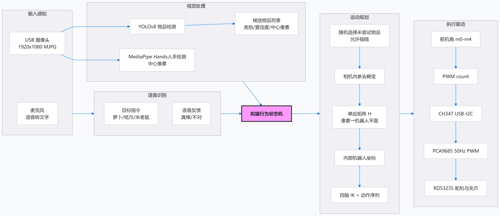

# Vision and Multimodal Four-Axis Robot Pet

A team-built desktop robot that recognizes objects and responds to speech or typed commands. Its cat-like interaction loop randomly tries an object, waits for human feedback, changes its choice after correction, and performs a reward motion after positive feedback.

**My contribution:** visual perception, multimodal interaction, and system integration. The application also contains the team's robot control and hardware integration modules; this is not a claim of independent design of the entire robot.

The physical project was completed and handed in. This repository is a curated source and evidence archive. The October 2026 archive checks are offline only; the original robot is no longer available for new hardware tests.

## What is included

- YOLOv8 detection for `carrot`, `mickey`, and `tissue`.
- OpenCV camera calibration and pixel-to-work-plane homography.
- Vosk offline Chinese commands, keyboard input, and MediaPipe hand detection.
- A cat-like feedback loop and a Windows CH347 → PCA9685 → servo control stack.
- Calibration artifacts and a historical training CSV with traceable summaries.



The diagram is an original project artifact. `keyboard` is an additional mode in the current source; see the current [architecture](docs/ARCHITECTURE.zh-CN.md).

## Evidence and limits

| Evidence | Value | Meaning |
|---|---:|---|
| Stored camera calibration RMS | 0.704410 px | Historical reprojection error |
| Stored homography RMS, 8 points | 7.145311 mm | Residual on calibration points |
| Historical validation mAP@0.5 | 0.86211, epoch 82 | Best row in the included training CSV |
| Historical validation mAP@0.5:0.95 | 0.67725, epoch 74 | A different row, not the same checkpoint |

These values are not physical grasp success rates. The training images, weights, vendor DLLs, virtual environments, and private working files are excluded. Source and calibration files alone do not make this a ready-to-run hardware package.

## Start here

```powershell
python -m pip install -r requirements.txt
python -B main.py --help
```

`--help` reads the command interface without starting a camera or robot. After providing the required assets and checking the target setup, the application supports `list_cameras`, `detect`, `voice`, `keyboard`, and `cat`. Hardware modes connect to the robot and can move it, including during initialization. Follow [running and assets](docs/RUNNING.zh-CN.md).

Current source preserves `GRIPPER_CLOSED_ANGLE = 15.0` and the 150 mm lift before the successful placement sequence. Historical notes mentioned 5°; this archive does not revert the current configuration.

## 中文资料

- [项目介绍与个人贡献](docs/PROJECT.zh-CN.md)
- [系统架构与交互逻辑](docs/ARCHITECTURE.zh-CN.md)
- [运行、外部资产与迁移](docs/RUNNING.zh-CN.md)
- [结果、验证范围与限制](docs/RESULTS_AND_LIMITATIONS.zh-CN.md)
- [来源、版权与归档边界](docs/CONTRIBUTIONS_AND_SOURCES.zh-CN.md)
- [历史训练记录](evidence/training/results.csv) / [指标摘要](evidence/training/summary.json)
- [本次离线检查](evidence/archive_validation.json)

## Rights and dependencies

Original source comments and notices are retained. No new blanket license is assigned to the team code. Third-party packages and externally obtained models/drivers retain their own terms; see [sources](docs/CONTRIBUTIONS_AND_SOURCES.zh-CN.md). Publication of this archive does not imply ownership of third-party assets or a license to redistribute excluded datasets.

Historical repository material: [calibration implementations](calibration/README.md) and [unimplemented ROS2 migration notes](docs/ROS2_MIGRATION_HISTORICAL.zh-CN.md). This update appends to the existing Git history; excluded assets in older commits have not been removed from history.
